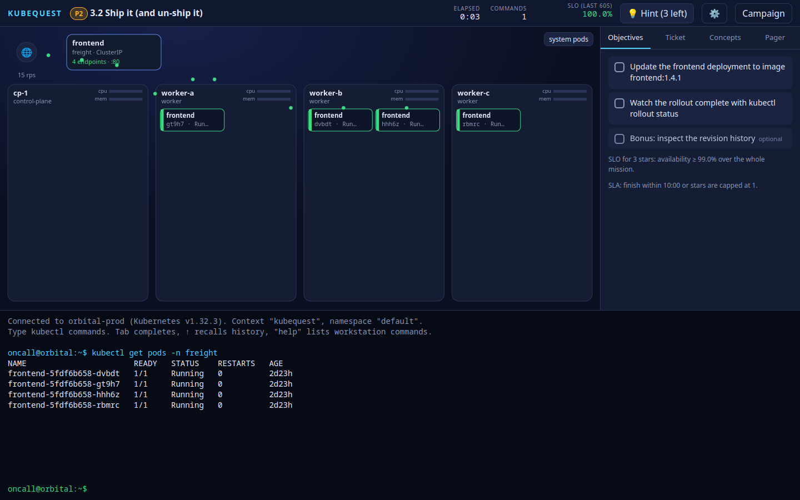

# Kubequest

**A desktop game that teaches Kubernetes by putting you on call.** You get tickets — onboarding
tasks, releases, pager-screaming incidents — and you resolve them with *real* `kubectl` commands
and *real* YAML against a simulated production cluster that reacts live on screen. Traffic flows,
pods crash-loop, rollouts roll, nodes die. Score, stars and a campaign that follows the
[Kubernetes Mastery curriculum](curriculum-full.md).

Nothing to install besides Node.js. No Docker, no cluster, no admin rights. Delete the folder and
the game is gone.



## Play

Requirements: **Node.js ≥ 22** (24 recommended) and npm. Linux, macOS or Windows.

```bash
npm install          # downloads the three dev dependencies into ./node_modules (incl. Electron)
npm start            # desktop window (Electron, portable mode)
# or
npm run web          # zero-native-deps fallback: local server + your default browser
```

Everything the game writes (player progress, Electron's own cache) lives under `./data` and
`./.cache` inside this folder. **Uninstall = delete the folder.** The browser build keeps progress
in that browser's `localStorage` instead.

### Controls
- Type `kubectl …` (or `k …`) in the terminal. **Tab** completes commands, resource types, names
  and files; **↑/↓** recall history; **Ctrl+C** aborts a running command; **Ctrl+L** clears.
- `help` lists the workstation commands (`ls`, `cat`, `vim`, `grep`, `curl`, `watch`, `&` …);
  `kubectl help` lists the supported kubectl matrix; `kubectl explain <kind>` works offline.
- Each ticket opens with a briefing: the ticket itself, short **field notes** that teach the
  concepts you are about to use and when they matter, and collapsible concept cards for reference.
- Completing an objective unlocks an **insight** in the Insights tab: what a senior engineer pairing
  with you would point out at that moment, to train your instincts without handing you the answer.
- The side panel has your **Objectives**, **Insights**, the **Ticket**, **Concepts** (field notes + cards) and the **Pager**
  (chaos events and hints). Hints cost score. The map on the left is the cluster: hover a pod.
- **⏸ Pause** freezes the whole simulation (cluster clock, traffic, timer, chaos) and blocks the
  terminal until you resume; **↺ Restart** rebuilds the ticket from its initial state.
- Settings (⚙): reduced motion, font size, unlock all tickets, export/import progress.

### What is in the campaign (v0.1)
| Chapter | Tickets | Curriculum |
|---|---|---|
| 0 Orientation | Welcome aboard | — |
| 1 Foundations | The image that wasn't | Stage 1 (images, registries, pulls) |
| 2 Hands-On | Where is everything? · Logs don't lie · Declarative by Friday · Inside the box | Stage 2 (kubectl fluency, debugging, declarative vs imperative) |
| 3 Workloads | Three of a kind · Ship it (and un-ship it) · Probe-ably fine · Out of memory · Night shift · **Capstone: Zero-downtime Friday** | Stage 3 (ReplicaSets, Deployments, probes, resources, Jobs/CronJobs/DaemonSets, drains) |
| 4 Networking | Nobody's home · Open to the world | Stage 4 (Services, endpoints, DNS, NodePort/LoadBalancer) |
| Sandbox | free play | — |

Stages 5–8 (configuration, storage, security, production operations, platform engineering) are
planned; the architecture already supports the resource kinds and controllers they need.

## Faithfulness

The simulator targets **kubectl / Kubernetes v1.32** output and semantics: table layouts, error
strings, Deployment rollout maths (maxSurge/maxUnavailable), CrashLoopBackOff timings, probe
semantics, scheduler messages, endpoints ↔ readiness, node eviction. Anything not implemented
fails honestly (`kubequest: … is not supported in the simulator yet`) rather than pretending.
Every mission ships with a scripted solution that runs as a test.

## Develop

```bash
npm run check        # typecheck + all tests (engine, kubectl golden output, mission solvability)
npm test             # tests only (node --test, no framework)
npm run build        # esbuild → dist/
npm run footprint    # verify nothing was written outside this folder
```

Open a ticket directly while developing: `npm run web` then
`http://127.0.0.1:PORT/?mission=3.2&script=kubectl get pods -n freight`.

Read `AGENTS.md` (working agreement) and `ARCHITECTURE.md` (module map) before changing code.
Product and design documents: `docs/PRD.md`, `docs/TECH_SPEC.md`, `docs/MVP_SCOPE.md`.

### Packaging (optional)
A release archive per OS can be produced with `@electron/packager` without adding runtime
dependencies: `npx --cache .cache/npm @electron/packager . kubequest --out release/ --overwrite`.
The result runs from the extracted folder and keeps its data inside it.

## License
MIT — see `LICENSE`.
