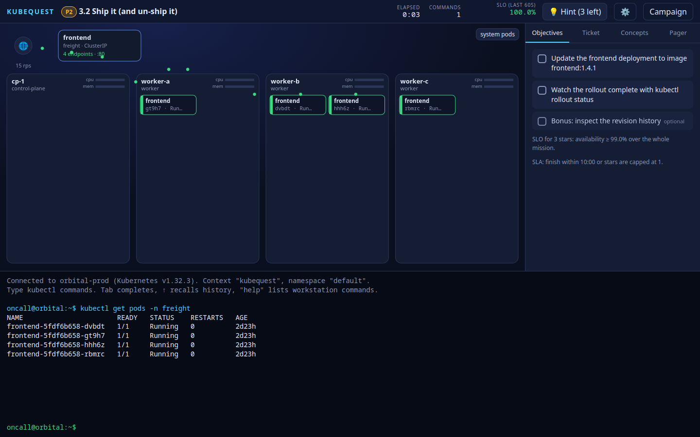

# KubeQuest

**A desktop game that teaches Kubernetes by putting you on call.** You get tickets — onboarding
tasks, releases, pager-screaming incidents — and you resolve them with *real* `kubectl` commands
and *real* YAML against a simulated production cluster that reacts live on screen. Traffic flows,
pods crash-loop, rollouts roll, nodes die. Score, stars and a campaign that follows the
[Kubernetes Mastery curriculum](curriculum-full.md).

Nothing to install besides Node.js. No Docker, no cluster, no admin rights. Delete the folder and
the game is gone.



## Play

Requirements: **Node.js ≥ 22** (24 recommended) and npm. Linux, macOS or Windows.

```bash
npm install          # downloads the three dev dependencies into ./node_modules (incl. Electron)
npm start            # desktop window (Electron, portable mode)
# or
npm run web          # zero-native-deps fallback: local server + your default browser
```

Everything the game writes (player progress, Electron's own cache) lives under `./data` and
`./.cache` inside this folder. **Uninstall = delete the folder.** The browser build keeps progress
in that browser's `localStorage` instead.

### Controls
- Type `kubectl …` (or `k …`) in the terminal. **Tab** completes commands, resource types, names
  and files; **↑/↓** recall history; **Ctrl+C** aborts a running command; **Ctrl+L** clears.
- `help` lists the workstation commands (`ls`, `cat`, `vim`, `grep`, `curl`, `watch`, `&` …);
  `kubectl help` lists the supported kubectl matrix; `kubectl explain <kind>` works offline.
- Each ticket opens with a briefing: the ticket itself, short **field notes** that teach the
  concepts you are about to use and when they matter, and collapsible concept cards for reference.
- Completing an objective unlocks an **insight** in the Insights tab: what a senior engineer pairing
  with you would point out at that moment, to train your instincts without handing you the answer.
- The side panel has your **Objectives**, **Insights**, the **Ticket**, **Concepts** (field notes + cards) and the **Pager**
  (chaos events and hints). Hints cost score. The map on the left is the cluster: hover a pod.
- **⏸ Pause** freezes the whole simulation (cluster clock, traffic, timer, chaos) and blocks the
  terminal until you resume; **↺ Restart** rebuilds the ticket from its initial state.
- Settings (⚙): reduced motion, font size, unlock all tickets, export/import progress.

### What is in the campaign
42 tickets in nine chapters, following `curriculum-full.md` stage by stage.

| Chapter | Tickets | Curriculum |
|---|---|---|
| 0 Orientation | Welcome aboard | — |
| 1 Foundations | The image that wasn't · The tag that moved | Stage 1 (images, tags and digests, registries, pulls) |
| 2 Hands-On | Where is everything? · Logs don't lie · Declarative by Friday · Inside the box | Stage 2 (kubectl fluency, debugging, declarative vs imperative) |
| 3 Workloads | Three of a kind · Ship it (and un-ship it) · Probe-ably fine · Out of memory · Night shift · **Capstone: Zero-downtime Friday** · Two in a pod · No shell, no problem | Stage 3 (ReplicaSets, Deployments, probes, resources, Jobs/CronJobs/DaemonSets, drains, sidecars and init containers, `kubectl debug`) |
| 4 Networking | Nobody's home · Open to the world · One door, many rooms · Gateway to the future · Default deny · **Capstone: The front door** | Stage 4 (Services, endpoints, DNS, NodePort/LoadBalancer, Ingress, Gateway API, NetworkPolicy) |
| 5 Config, State & Security | Config is not code · Data that outlives the Pod · Pets with names · Least privilege · Run as nobody · Policy as code · **Capstone: The vault** | Stage 5 (ConfigMaps, Secrets, PV/PVC/StorageClass, StatefulSets, RBAC, securityContext, Pod Security Admission, ValidatingAdmissionPolicy, private registries) |
| 6 Running in Production | A place for everything · Elastic · Budget for disruption · Fair shares · Upgrade window · **Capstone: Peak day** | Stage 6 (taints, affinity, topology spread, HPA, PodDisruptionBudgets, quotas and LimitRanges, version skew and removed APIs, node upgrades) |
| 7 Delivery & Extension | One base, many environments · Charts and releases · Git is the source of truth · Teach the cluster a new word · **Capstone: Hands off prod** | Stage 7 (Kustomize, Helm, GitOps with Argo CD, CRDs and operators) |
| 8 Specialization Tracks | The GPU queue · A new tenant · Game day | Stage 8 (GPU scheduling, multi-tenancy, chaos engineering) |
| Sandbox | free play | — |

Topics the curriculum lists that a kubectl terminal cannot exercise (service meshes, eBPF tooling,
observability stacks, WebAssembly runtimes, managed-cloud specifics) are covered as concept cards
and debrief notes rather than as simulated systems.

## Faithfulness

The simulator targets **kubectl / Kubernetes v1.32** output and semantics: table layouts, error
strings, Deployment rollout maths (maxSurge/maxUnavailable), CrashLoopBackOff timings, probe
semantics, scheduler messages, endpoints ↔ readiness, node eviction, admission and RBAC errors.
The delivery tools on the workstation follow their upstream output too: Kustomize v5.5 (including
the name-suffix hash), Helm v3, git, and the Argo CD `Application` status. Anything not implemented
fails honestly (`kubequest: … is not supported in the simulator yet`) rather than pretending.
Every mission ships with a scripted solution that runs as a test.

## Develop

```bash
npm run check        # typecheck + all tests (engine, kubectl golden output, mission solvability)
npm test             # tests only (node --test, no framework)
npm run build        # esbuild → dist/
npm run footprint    # verify nothing was written outside this folder
```

Open a ticket directly while developing: `npm run web` then
`http://127.0.0.1:PORT/?mission=3.2&script=kubectl get pods -n freight`.

Read `AGENTS.md` (working agreement) and `ARCHITECTURE.md` (module map) before changing code.
Product and design documents: `docs/PRD.md`, `docs/TECH_SPEC.md`, `docs/MVP_SCOPE.md`.

### Packaging
Installers are built with `electron-builder` (a dev dependency; the game itself still has zero
runtime dependencies). Each platform builds on its own OS:

```bash
npm run build:linux  # AppImage + deb into release/
npm run build:win    # Windows NSIS installer (run on Windows)
npm run build:mac    # macOS dmg, arm64 + x64 (run on macOS)
```

CI (`.github/workflows/build.yml`) builds all three platforms on native runners: manually via
_Run workflow_ (`gh workflow run build.yml`), or by pushing a `v*` tag, which also drafts a
GitHub release with the artifacts. electron-builder's cache stays in `./.cache/electron-builder`.

Linux packages ship a launcher (`scripts/after-pack.cjs`) that keeps Chromium's sandbox when the
system supports one (SUID helper or unprivileged user namespaces) and otherwise falls back to
`--no-sandbox` — without it, AppImages abort on distros that restrict user namespaces
(Ubuntu 23.10+).

An installed app cannot write next to itself (asar, `/opt`, AppImage mount, Program Files), so
it keeps progress in Electron's standard per-user data directory (`~/.config/kubequest` on
Linux, `~/Library/Application Support/kubequest` on macOS, `%APPDATA%\kubequest` on Windows).
Running from source (`npm start`) stays fully portable as described above. To brand the
installers, add a 512×512 `build/icon.png`; until then they use Electron's default icon.

## License
MIT — see `LICENSE`.
